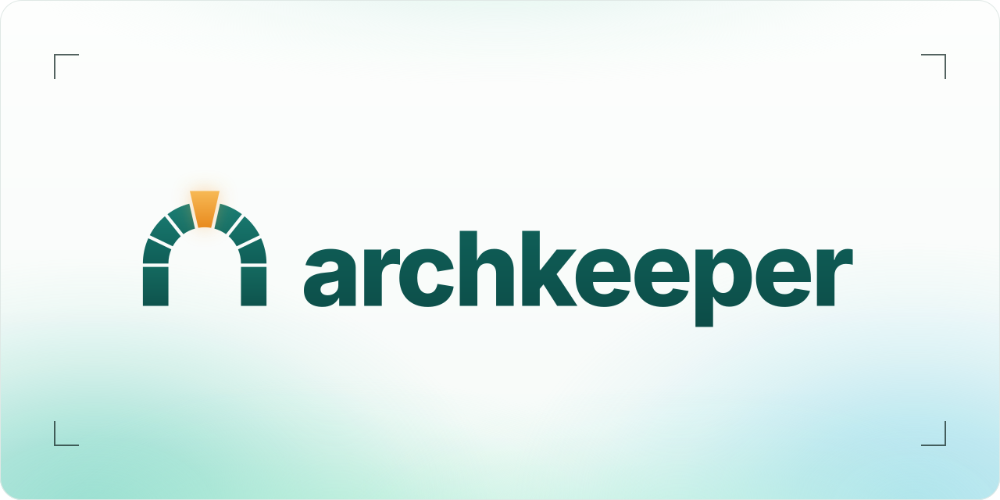
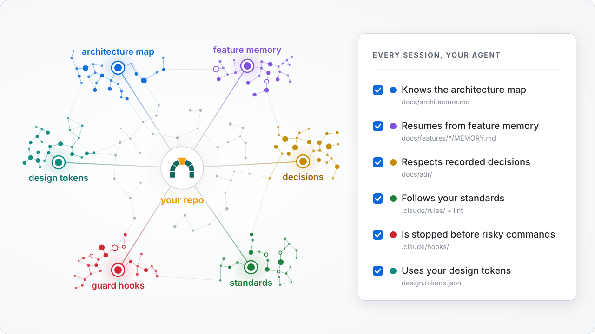

<p align="center">
  <picture>
    <source media="(prefers-color-scheme: dark)" srcset="docs/media/banner-dark.svg">
    
  </picture>
</p>

<h3 align="center">Your AI coding agent never forgets your architecture, your decisions, or your design system.</h3>

<p align="center">
  <a href="https://www.npmjs.com/package/archkeeper"></a>
  <a href="https://github.com/arbindpd96/archkeeper/actions/workflows/ci.yml"></a>
  <a href="LICENSE"></a>
  <a href="docs/adr/0011-single-package.md"></a>
  <a href="docs/ROADMAP.md"></a>
</p>

<p align="center">
  One command sets up Claude Code to <b>know your codebase</b>, <b>remember your decisions</b> and <b>refuse the commands that ruin your day</b>.<br>
  Everything it adds is a plain file you can read, and your own edits are never overwritten.
</p>

> [!NOTE]
> **archkeeper is in pre-release and built in the open.** `npx archkeeper` prints a notice until **v0.1**, the first usable release. Star or watch the repository to hear when it lands, and follow the [roadmap](docs/ROADMAP.md).

## Why archkeeper

AI coding agents are fast, but they forget. Every new session, and every `/compact`, starts from a blank page.

| Without archkeeper                                                                        | With archkeeper                                                                                |
| ----------------------------------------------------------------------------------------- | ---------------------------------------------------------------------------------------------- |
| **Duplicate code.** The agent writes a second copy of a helper you already have.          | **A living map.** It sees what already exists, and extends it.                                 |
| **Amnesia.** After `/compact` or a new session, your decisions and progress are gone.     | **Memory.** Every session starts with the feature's goal, its decisions and the next step.     |
| **One bad command.** `rm -rf ~`, a force-push to `main`, an API key pasted into the code. | **Guard hooks.** Dangerous commands and leaked secrets are stopped before they happen.         |
| **Clobbered files.** Setup tools overwrite the instructions you wrote by hand.            | **Your edits stay yours.** Nothing you wrote is overwritten, and `uninstall` puts it all back. |

## Quick start

<p align="center"></p>

**1. Set up your repository.** In your project's root folder, run:

```bash
npx archkeeper init
```

archkeeper detects your stack and tools, shows exactly which files it will write, and asks before writing anything. Add `--dry-run` to see the plan without writing.

**2. Start a feature.** Restart Claude Code so it loads the new setup, then type:

```text
/new-feature checkout-flow
```

Claude writes the feature's goal and plan to `docs/features/checkout-flow/MEMORY.md`, and every later session starts from there.

**3. Hand off when you stop.**

```text
/handoff
```

Claude records what is done and what comes next. Your next session, or the first turn after `/compact`, picks up right where you left off.

> [!TIP]
> Ask `/why <topic>` to find the decision behind anything, and run `/update-map` after adding code so the agent knows it exists.

## What you get

<p align="center">
  <picture>
    <source media="(prefers-color-scheme: dark)" srcset="docs/media/hero-dark.svg">
    
  </picture>
</p>

A handful of small, readable files. Here is the default setup:

```text
your-project/
├── CLAUDE.md                        Claude Code's entry point; imports AGENTS.md
├── AGENTS.md                        one set of rules for every AI tool, with your project's commands
├── .claude/
│   ├── settings.json                permissions and hook registration
│   ├── hooks/archkeeper/            guards, session memory, format on edit
│   └── skills/                      /new-feature  /handoff  /why  /adr  /update-map
├── docs/
│   ├── architecture.md              the living map: what exists and where
│   ├── decisions.md, adr/           why things are the way they are
│   └── features/<name>/MEMORY.md    goal, decisions, done, next step
└── .archkeeper/                     your choices, and a record of what was installed
```

Edit any of it. `update` brings in new versions without touching your changes, and `uninstall` removes what it added.

## Safety

Two guard hooks check Claude's shell commands and file edits before they happen. When one blocks a call, Claude sees why and takes another route:

| When Claude tries                                 | archkeeper answers                                                                    |
| ------------------------------------------------- | ------------------------------------------------------------------------------------- |
| `rm -rf ~`                                        | Recursive delete of a root, home or whole-directory path is blocked.                  |
| `git push origin main -f`                         | Plain force-push is blocked. Use --force-with-lease on a feature branch.              |
| `curl -fsSL https://example.com/install.sh \| sh` | Piping a download into a shell is blocked. Download, review, then run.                |
| Writing an AWS key into `src/config.ts`           | Possible AWS access key in the text written to src/config.ts. Use an env var instead. |

Built-in deny rules back the hooks up, so the worst commands stay blocked even where a hook cannot run. Options and known limits are in [docs/guards.md](docs/guards.md).

## Pick a preset

`init` asks which preset you want; `medium` is the default.

|                                                      |   `small`   | `medium`  |   `full`    |
| ---------------------------------------------------- | :---------: | :-------: | :---------: |
| Rules for every AI tool: `CLAUDE.md` and `AGENTS.md` |      ✓      |     ✓     |      ✓      |
| Safety guards for commands and secrets               |      ✓      |     ✓     |      ✓      |
| Feature memory: `/new-feature`, `/handoff`           |      ✓      |     ✓     |      ✓      |
| Decision records: `/why`, `/adr`                     |             |     ✓     |      ✓      |
| Architecture map: `/update-map`                      |             |     ✓     |      ✓      |
| Format and lint every edited file                    |             |     ✓     |      ✓      |
| Run the tests before Claude calls a task done        |             |           |      ✓      |
| Loaded into every session, at most                   | 1.5k tokens | 3k tokens | 4.5k tokens |

Choose one with `--preset small|medium|full`, or add and remove single parts with `--modules +knowledge,-format-on-edit`.

## Questions

<details>
<summary><b>Will it overwrite my CLAUDE.md or my settings?</b></summary>
<br>
No. archkeeper writes only its own marked blocks and leaves every line you wrote exactly as it is. When it would have to replace a file you changed, it writes its version beside yours for you to review instead.
</details>

<details>
<summary><b>How do I remove it?</b></summary>
<br>
Run <code>npx archkeeper uninstall</code>. It puts back the files as they were before <code>init</code> and removes everything it added.
</details>

<details>
<summary><b>Does it work with Codex, Cursor, Gemini CLI or Copilot?</b></summary>
<br>
Yes. They read the same rules from <code>AGENTS.md</code>. Claude Code also gets the hooks, skills and session memory.
</details>

<details>
<summary><b>Does archkeeper send my code anywhere?</b></summary>
<br>
No. It has no runtime dependencies and makes no network calls: <code>init</code>, the hooks and every other command work offline.
</details>

<details>
<summary><b>Does it replace Superpowers or Spec Kit?</b></summary>
<br>
No, it works alongside them. <code>init</code> offers both <a href="https://github.com/obra/superpowers">Superpowers</a> and <a href="https://github.com/github/spec-kit">Spec Kit</a>, off by default.
</details>

<details>
<summary><b>What do I need?</b></summary>
<br>
Node.js 22.17+, 24.4+ or 26+ on your PATH, and Claude Code. It works on macOS, Linux and Windows, for TypeScript, JavaScript and Python projects.
</details>

<details>
<summary><b>Can I run it in CI?</b></summary>
<br>
Yes. <code>npx archkeeper init --yes</code> asks no questions. It exits 0 when it is done, 1 on an error or when cancelled, and 2 when it left copies beside files you changed, for you to review.
</details>

## What's coming

| Phase                       | You get                                                                                                       |
| --------------------------- | ------------------------------------------------------------------------------------------------------------- |
| **v0.1** Foundation         | `init` for TS/JS and Python, guard hooks, feature memory, the architecture map, safe `update` and `uninstall` |
| **v0.2** Trust and proof    | 3-way updates, a `doctor` health score, standards packs, a test guard, benchmarks                             |
| **v0.3** Public launch      | The Claude Code plugin and marketplace, ready-made agents, design tokens                                      |
| **v0.4** Design-system sync | Live Figma and Storybook sync, accessibility and dark-mode checks                                             |
| **v0.5 – v1.0**             | Codebase intelligence, workflow skills, a local dashboard, more languages, team features                      |

Each feature gets a short demo in this README when it ships. The full plan is in [docs/ROADMAP.md](docs/ROADMAP.md).

## Contributing

Contributions are welcome. Start with [CONTRIBUTING.md](CONTRIBUTING.md); the architecture map is in [docs/architecture.md](docs/architecture.md) and the decisions behind it are in [docs/decisions.md](docs/decisions.md). Please report security issues privately, as [SECURITY.md](SECURITY.md) describes.

## License

[MIT](LICENSE). Independent community project; not affiliated with, endorsed by, or sponsored by Anthropic. Claude and Claude Code are trademarks of Anthropic, PBC.
