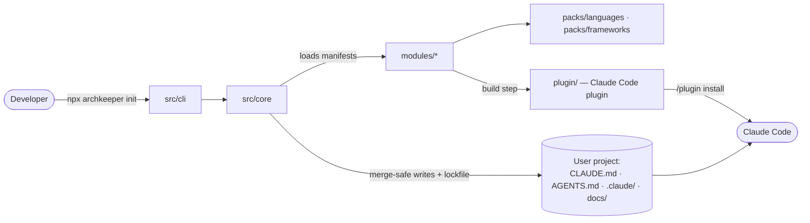

# Architecture map

> The living map of archkeeper. Read it before creating anything new; update it (or run `/update-map`) after adding a
> source layer, module, pack or shared util. Status: **v0.1 M6 map, in progress: init's Superpowers and Spec Kit offers, which only print their install commands (`modules/compose.json`), the stop-check module in full, which runs the project's tests before Claude stops once a command is set, format-on-edit, which formats and lints each edited file with the project's own tools, and the architecture-map module's `docs/architecture.md` and `/update-map`, in medium and full, on M5's feature memory and decisions, M4's guards and M3's `init`** (see `docs/ROADMAP.md`). Rows marked _planned_ are the agreed target (handoff §8, ADR-0002/0003/0011).

## Overview

- **One source of truth.** Modules hold templates, hooks, skills and agents. The CLI writes hooks, instructions, rules, settings and (by default) skills into the project. From v0.3 the build emits only skills and agents into `plugin/`, never hooks ([ADR-0016](adr/0016-delivery-split.md)).
- **One package, zero runtime dependencies** (ADR-0011). Every library is a devDependency that tsdown inlines. The published `files` are `dist`, `modules`, `packs` and `schema`.
- **Core is pure.** It does module resolution, rendering, merge planning and the lockfile. The CLI owns prompts, output and exit codes.
- **Layers are lint-enforced** (ESLint `no-restricted-*` rules in `eslint.config.mjs`; each is proven by a fixture in `test/fixtures/layers/`):
  - `src/core` never imports `src/cli`, commander or @clack/prompts. It never uses `process` or `console`, whether as a global, through `globalThis`, or imported from `process`, `console` or their `node:` forms, and never imports `fs` or `fs/promises`: callers pass file contents in through an injected reader. It never imports `zlib` either: core hashes blob content, and `src/cli` compresses it. It starts no process and opens no connection (`child_process`, `worker_threads`, `net`, `http`, `https`, `http2` and `dgram` are refused), so stack detection is pure by construction.
  - The install engine splits along that line: `src/core` plans every write and merge purely (`planInstall`), and `src/cli` reads the snapshot and applies the plan transactionally (`install`).
  - `src/hooks` imports only `node:` built-ins and `src/hooks/runtime`, and no hook file imports a network module (`net`, `http`, `https`, `http2`, `tls`, `dgram`, `dns`) or uses `fetch`, `WebSocket`, `XMLHttpRequest` or `EventSource` (ADR-0018).
  - `src/hooks/runtime` imports no npm package.

## Repository layout

| Path                      | Purpose                                                                                                                                                                                      | Status           |
| ------------------------- | -------------------------------------------------------------------------------------------------------------------------------------------------------------------------------------------- | ---------------- |
| `src/cli/`                | npx entry: Node version check, commander, the command registry, `init` and its prompts, the transactional apply                                                                              | active           |
| `src/core/`               | Brand, errors, manifests, config, resolution, renderer, install planner, strategies, lockfile, stack detection                                                                               | active           |
| `src/hooks/`              | Hook sources (one self-contained bundle each) and the shared hook runtime in `src/hooks/runtime/`                                                                                            | active           |
| `modules/<id>/`           | One switchable feature: `module.json` and `files/`; `modules/presets.json` holds the preset chain and `modules/compose.json` the compose offers                                              | active           |
| `packs/languages/<lang>/` | Language rules, linter configs, detection (TS/JS, Python first)                                                                                                                              | _planned v0.1–2_ |
| `packs/frameworks/<fw>/`  | Framework rules and detection                                                                                                                                                                | _planned v0.2+_  |
| `schema/`                 | JSON Schemas of the config, lock and module manifest, generated from `src/core` (`npm run schema`); published                                                                                | active           |
| `plugin/`                 | Generated Claude Code plugin, kept in the repo for the marketplace; never published to npm (ADR-0016)                                                                                        | _planned v0.3_   |
| `benchmarks/`             | With-vs-without-kit harness (not published)                                                                                                                                                  | _planned v0.2_   |
| `examples/`               | Fixtures `ts-app`, `py-app`, `mixed` for tests and tapes; not linted, formatted, covered or published                                                                                        | active           |
| `scripts/`                | Repo checks and CI gates, license file, tape rendering, release guards and packing; helpers in `lib.mjs`                                                                                     | active           |
| `docs/`                   | This map, decisions/ADRs, roadmap, release runbook (`releasing.md`), the guards reference (`guards.md`), feature memories, research                                                          | active           |
| `.claude/`                | This repo's own Claude Code setup (dogfooding)                                                                                                                                               | active           |
| `test/`                   | Vitest suites for hooks, scripts and lint rules, plus `helpers.ts`; `fixtures/` is kept out of `npm run lint`; `__snapshots__/` holds the install, per-module and golden-tree file snapshots | active           |
| `.github/`                | CI, release (staged publish), demo-gifs, CodeQL and PR-title workflows; issue forms; Dependabot                                                                                              | active           |
| `.husky/`                 | Git hooks: lint-staged on commit, commitlint on message                                                                                                                                      | active           |
| `.changeset/`             | Changesets config and pending changesets; the maintainer versions locally (ADR-0013)                                                                                                         | active           |

## Index

Add a row whenever something is created. Keep one line per item.

### Source layers

| Path                                                                                                                                                  | Purpose                                                                                                                                                                                                                                                                                                                                                                                    | Key exports                                                                                                                                                           |
| ----------------------------------------------------------------------------------------------------------------------------------------------------- | ------------------------------------------------------------------------------------------------------------------------------------------------------------------------------------------------------------------------------------------------------------------------------------------------------------------------------------------------------------------------------------------ | --------------------------------------------------------------------------------------------------------------------------------------------------------------------- |
| `src/core/brand.ts`                                                                                                                                   | The only place the product slug is written; every name, path and marker derives from it                                                                                                                                                                                                                                                                                                    | `BRAND`, `Brand`                                                                                                                                                      |
| `src/core/errors.ts`                                                                                                                                  | `ArchkeeperError` and its subclasses: the message names the file, the JSON path or line, and a `Try:` fix                                                                                                                                                                                                                                                                                  | `ArchkeeperError`, `ManifestError`, `ConfigError`, `ResolveError`, `RenderError`, `MergeError`, `PathSafetyError`, `LockError`, `ApplyError`, `UsageError`, `Finding` |
| `src/core/imports.ts`                                                                                                                                 | `importProblem`: refuses `@` imports of outside or private files (`.env*`, CLAUDE.local.md) wherever Claude Code finds them; `withoutComments` cuts HTML comments in linear time                                                                                                                                                                                                           | `importProblem`, `withoutComments`                                                                                                                                    |
| `src/core/paths.ts`                                                                                                                                   | Refuses absolute, backslash, `:`, control-character, `..` and trailing-dot paths before any file-system check (#23); targets use portable ASCII names                                                                                                                                                                                                                                      | `relativePathProblem`, `targetPathProblem`, `hasControlCharacter`, `foldedPath`, `RELATIVE_PATH_HINT`, `TARGET_PATH_HINT`                                             |
| `src/core/json.ts`                                                                                                                                    | Parses JSON with `JSON.parse` and locates the first syntax error with jsonc-parser                                                                                                                                                                                                                                                                                                         | `parseJson`, `JsonResult`, `lineAndColumn`, `parseErrorWords`, `isRecord`                                                                                             |
| `src/core/issues.ts`                                                                                                                                  | Turns zod's first issue into a finding with a JSON path, a problem and a fix                                                                                                                                                                                                                                                                                                               | `checkSchema`, `describeIssue`, `jsonPath`                                                                                                                            |
| `src/core/schema-parts.ts`                                                                                                                            | Shared zod pieces: stacks, kebab ids, option names, one-line text, safe relative paths and portable targets                                                                                                                                                                                                                                                                                | `STACKS`, `Stack`, `kebabId`, `relativePath`, `targetPath`, `described`, `listOf`, `refusing`                                                                         |
| `src/core/manifest-schema.ts`                                                                                                                         | The zod contract of `modules/<id>/module.json` and `modules/presets.json` (#18)                                                                                                                                                                                                                                                                                                            | `moduleManifestSchema`, `presetCatalogSchema`, `HOOK_EVENTS`, `ModuleManifest`, `ignoreLineProblem`, `SETTINGS_FILE`, `MCP_FILE`, `GITIGNORE_FILE`                    |
| `src/core/mcp-schema.ts`                                                                                                                              | The zod contract of one `.mcp.json` server: `${NAME}`-only env, headers and query values, no credential variables in remote `url` or `headers`                                                                                                                                                                                                                                             | `mcpServerSchema`                                                                                                                                                     |
| `src/core/manifest-rules.ts`                                                                                                                          | Cross-field manifest rules: demo or internal, reserved targets, no allow rules, declared files, no repeats                                                                                                                                                                                                                                                                                 | `manifestRuleFinding`                                                                                                                                                 |
| `src/core/targets.ts`                                                                                                                                 | Refuses template targets the kit builds from data or never writes: settings and `.mcp.json` at any depth, `.env*`, `.git`, kit dirs, sidecars                                                                                                                                                                                                                                              | `reservedTarget`, `LOCAL_SETTINGS_FILE`, `KitFolders`                                                                                                                 |
| `src/core/loader.ts`                                                                                                                                  | Loads modules, their templates and hook scripts, the preset chain and the compose offers through an injected reader; refuses unknown `conflicts` ids                                                                                                                                                                                                                                       | `loadModule`, `loadCatalog`, `manifestPath`, `templatePath`, `ReadKitFile`, `KitModule`, `Catalog`                                                                    |
| `src/core/config-schema.ts`                                                                                                                           | The zod contract of `.archkeeper/config.json`: version, preset, modules, stack, options, compose (ADR-0014)                                                                                                                                                                                                                                                                                | `configSchema`, `ProjectConfig`, `CONFIG_VERSION`                                                                                                                     |
| `src/core/compose-schema.ts`                                                                                                                          | The zod contract of `modules/compose.json` (#39, ADR-0008): for each tool the config's `compose` names, its known-good version, the exact commands init prints and never runs, and the skill names and prefixes the kit's skills stay apart from                                                                                                                                           | `composeCatalogSchema`, `ComposeCatalog`, `ComposeTool`                                                                                                               |
| `src/core/config.ts`                                                                                                                                  | Parses the project config: unknown keys warn, invalid values and newer versions throw `ConfigError`; the versioned jsDelivr `$schema` URL a new config gets                                                                                                                                                                                                                                | `parseConfig`, `configPath`, `configSchemaUrl`, `ParsedConfig`                                                                                                        |
| `src/core/options.ts`                                                                                                                                 | Merges config options over each module's typed defaults (a boolean, number, string, list of strings or list of commands, each an argument array); a wrong type throws with the option's description                                                                                                                                                                                        | `resolveOptions`, `moduleOptions`, `optionDefaults`, `ResolvedOptions`                                                                                                |
| `src/core/when.ts`                                                                                                                                    | Evaluates a manifest `when` against the stack, the detected tools of the stacks in effect and the option values, returning the reason it fails                                                                                                                                                                                                                                             | `whenMismatch`, `When`                                                                                                                                                |
| `src/core/resolve.ts`                                                                                                                                 | Resolves a preset plus `modules.add`/`remove` into modules, adding requirements and leaving out failed `when`s, each with its reason                                                                                                                                                                                                                                                       | `resolveModules`, `ResolveRequest`, `Resolution`                                                                                                                      |
| `src/core/install-order.ts`                                                                                                                           | Topological install order with ties broken by id; a cycle throws `ResolveError` showing it                                                                                                                                                                                                                                                                                                 | `installOrder`                                                                                                                                                        |
| `src/core/text.ts`                                                                                                                                    | Locale-independent string order and LF normalisation, shared by the resolver, the renderer and the hashes; the byte-order mark; the characters no printed lock value may hold, escaped on one line or on many; `isRecord`, `isStringList` and `isCommandList`, which init, the option resolver and hooks share without `jsonc-parser`                                                      | `compareText`, `asLfText`, `toLf`, `BYTE_ORDER_MARK`, `UNPRINTABLE`, `escapeUnprintable`, `escapeUnprintableKeepingLines`, `quoted`, `isRecord`, `isStringList`       |
| `src/core/markdown-headings.ts`                                                                                                                       | The ATX headings of Markdown lines outside fenced code blocks, a fence closed as CommonMark closes it, in linear time; it imports nothing, so `scripts/demo-rules.mjs` loads it from source, and the memory hooks find their sections with it                                                                                                                                              | `markdownHeadings`, `MarkdownHeading`                                                                                                                                 |
| `src/core/template.ts`                                                                                                                                | Logic-less `{{a.b}}` templates with `\{{` for a literal `{{`; a list of lines is the one multi-line value; `toImport` writes `@path` imports; `unsafeValue` checks every line                                                                                                                                                                                                              | `renderTemplate`, `brandScope`, `toImport`, `unsafeValue`, `TemplateScope`                                                                                            |
| `src/core/secrets.ts`                                                                                                                                 | The one list of linear-time secret patterns the renderer and guard-secrets share, plus random-looking values assigned to secret names: a line's kinds of likely secret, or the first line that holds one, never echoing it                                                                                                                                                                 | `findSecret`, `secretKinds`, `SecretFinding`                                                                                                                          |
| `src/core/render-json.ts`                                                                                                                             | Builds `.claude/settings.json` (exec-form hooks, permissions) and `.mcp.json` entries from objects, and the owned keys of hook registrations and permission rules                                                                                                                                                                                                                          | `settingsPart`, `mcpPart`, `hookScriptPath`, `hookArgument`, `hookKey`, `permissionKey`, `PERMISSION_LISTS`, `toJson`                                                 |
| `src/core/render-tree.ts`                                                                                                                             | Groups rendered entries by path in sorted order and refuses two modules writing one file, block or JSON entry                                                                                                                                                                                                                                                                              | `collectEntries`, `RenderTree`, `RenderedEntry`                                                                                                                       |
| `src/core/render.ts`                                                                                                                                  | Renders modules for a stack, options and brand into a deterministic virtual tree that holds no secret or stray block marker (#20)                                                                                                                                                                                                                                                          | `render`, `RenderContext`                                                                                                                                             |
| `src/core/opt-out.ts`                                                                                                                                 | A module's `optOut` option (ADR-0014): what it may name, what it leaves out of the render, which entries name nothing, and the `Ownable` that lets a plan remove what the kit wrote and the user left unchanged                                                                                                                                                                            | `OPT_OUT`, `withoutOptedOut`, `optedOutEntries`, `optOutNames`, `unknownOptOuts`, `optOutOwnable`, `hookName`                                                         |
| `src/core/path-safety.ts`                                                                                                                             | Refuses write and delete targets: absolute, drive, UNC, `..`, `\`, `:`, NUL, `.git`/`GIT~1`, Windows device names, trailing dot or space (#23)                                                                                                                                                                                                                                             | `pathSafetyProblem`, `assertSafePath`                                                                                                                                 |
| `src/core/markers.ts`                                                                                                                                 | The one marker regex `render` refuses in values and the parser reads as markers; marker lines per style; legacy slugs                                                                                                                                                                                                                                                                      | `markerPattern`, `markerIn`, `markerStyle`, `markerLine`, `parseMarker`                                                                                               |
| `src/core/blocks-file.ts`                                                                                                                             | Splits a blocks file into user text and blocks, keeping every byte; broken or repeated markers throw `MergeError` with the line                                                                                                                                                                                                                                                            | `parseBlocks`, `emptyBlocks`, `blockParts`, `BlocksFile`                                                                                                              |
| `src/core/blocks-edit.ts`                                                                                                                             | Replaces, removes and inserts blocks in the file's EOL and BOM; an `@`-imports block goes first, after any YAML frontmatter's closing line, never in a block                                                                                                                                                                                                                               | `editBlocks`, `BlockEdits`, `NewBlock`                                                                                                                                |
| `src/core/hash.ts`                                                                                                                                    | sha256 of LF-normalised content, the form of every lock hash and blob name, and of exact bytes                                                                                                                                                                                                                                                                                             | `contentHash`, `exactHash`, `HASH`                                                                                                                                    |
| `src/core/version.ts`                                                                                                                                 | Semantic-version precedence, for "a kit older than the lock refuses to run"                                                                                                                                                                                                                                                                                                                | `compareVersions`, `SEMVER`                                                                                                                                           |
| `src/core/json-keys.ts`                                                                                                                               | The owned-key form of a JSON entry (`$schema`, permission rule, hook by event and script, MCP server) and its container                                                                                                                                                                                                                                                                    | `JSON_KEY`, `entryKey`, `SCHEMA_KEY`, `EntryKey`                                                                                                                      |
| `src/core/lock-schema.ts`                                                                                                                             | The zod contract of `<state dir>/lock.json` v1, exported to `schema/lock.schema.json`; paths pass path safety, hashes are 64 hex (ADR-0014)                                                                                                                                                                                                                                                | `lockSchema`, `LOCKFILE_VERSION`                                                                                                                                      |
| `src/core/lock.ts`                                                                                                                                    | Reads the untrusted lock (newer format or kit refused, conflict markers split into sides), writes it with sorted keys, and names the hashes it keeps blobs of                                                                                                                                                                                                                              | `readLock`, `serializeLock`, `emptyLock`, `blobHashes`, `lockFilePath`, `Lock`, `FileEntry`, `BlockEntry`, `Removal`, `KitId`                                         |
| `src/core/lock-rebuild.ts`                                                                                                                            | Rebuilds a lock left with conflict markers: newer kit's entries, union of `removed[]`, bases from known content on disk                                                                                                                                                                                                                                                                    | `rebuildLock`                                                                                                                                                         |
| `src/core/plan-types.ts`                                                                                                                              | The planner's vocabulary: the snapshot, the nine operation kinds, one path's outcome, the `Ownable` predicate                                                                                                                                                                                                                                                                              | `PathState`, `Snapshot`, `OpKind`, `PlanOp`, `PathOutcome`, `Ownable`                                                                                                 |
| `src/core/sidecar.ts`                                                                                                                                 | Sidecar paths and when a sidecar may be written: missing, unedited kit sidecar, never one the user edited; a skip that moves a lock entry is an adopt                                                                                                                                                                                                                                      | `sidecarPath`, `sidecarAction`, `keptSidecarReason`, `settledOp`, `EntryChange`                                                                                       |
| `src/core/file-plan.ts`                                                                                                                               | The owned and create-only strategies: rewrite unchanged, sidecar for user edits and first contact, adopt identical, record deletions                                                                                                                                                                                                                                                       | `planFile`, `FileJob`                                                                                                                                                 |
| `src/core/blocks-plan.ts`                                                                                                                             | The blocks strategy: per block against its base; one sidecar per file; deleted blocks go to `removed[]`                                                                                                                                                                                                                                                                                    | `planBlocks`, `BlocksJob`                                                                                                                                             |
| `src/core/blocks-unwritable.ts`                                                                                                                       | A blocks path the kit never writes through (a symlink): unseen kit blocks go to the sidecar as `pending`; a deleted sidecar marks them seen                                                                                                                                                                                                                                                | `planUnwritableBlocks`                                                                                                                                                |
| `src/core/json-entries.ts`                                                                                                                            | Finds, hashes (canonical JSON) and edits owned entries through jsonc-parser `modify`, keeping comments and the file's indentation                                                                                                                                                                                                                                                          | `parseDocument`, `findEntry`, `entryHash`, `entryValue`, `containerProblem`, `editDocument`, `formattingOf`                                                           |
| `src/core/json-plan.ts`                                                                                                                               | The json strategy: a user's entry under a kit key stays theirs, diverged entries kept, `$schema` only where absent, hooks only for kit scripts                                                                                                                                                                                                                                             | `planJson`, `JsonJob`, `SETTINGS_SCHEMA`                                                                                                                              |
| `src/core/plan.ts`                                                                                                                                    | The pure install planner (#21): ordered, reasoned operations, the bytes to write and the next lock; adds the kit's `.gitattributes` block                                                                                                                                                                                                                                                  | `planInstall`, `snapshotPaths`, `withStateBlock`, `STATE_BLOCK`, `Plan`, `PlanContext`                                                                                |
| `src/core/plan-summary.ts`                                                                                                                            | Groups a plan by path as create, modify, conflict (a sidecar) and skip, and condenses it by folder for init's short plan; names the sidecars still waiting, from this run or the lock's `pending` (#27)                                                                                                                                                                                    | `summarizePlan`, `condensePlan`, `pendingSidecars`, `PathSummary`, `PlanGroup`, `PlanRow`                                                                             |
| `src/core/unified-diff.ts`                                                                                                                            | A `diff -u` style unified diff of one file with three lines of context, compared as LF, for `--dry-run`                                                                                                                                                                                                                                                                                    | `unifiedDiff`                                                                                                                                                         |
| `src/core/stack-profile.ts`                                                                                                                           | Detection's vocabulary: the injected `ProjectView`, languages and their printed names, the stack summary init and the map print, tools by job, frameworks, command purposes and the `StackProfile` (#25)                                                                                                                                                                                   | `ProjectView`, `StackProfile`, `LANGUAGE_NAMES`, `stackSummary`, `DetectedCommand`, `ClaudeSetup`, `TOOL_JOBS`, `PURPOSES`, `recordOf`, `stringsOf`, `inOrder`        |
| `src/core/detect.ts`                                                                                                                                  | Pure stack detection over a `ProjectView`: merges the TS/JS and Python signals, root docs and an existing Claude setup (#25, ADR-0006)                                                                                                                                                                                                                                                     | `detectStack`                                                                                                                                                         |
| `src/core/detect-node.ts`                                                                                                                             | package.json signals: the manager by package-manager-detector's rules, from the project up to its repository root, tools, frameworks, workspaces, Yarn Plug'n'Play's loader, `run` commands of fixed scripts, each marked when its script starts a watcher such as `jest --watch`                                                                                                          | `nodeSignals`                                                                                                                                                         |
| `src/core/detect-python.ts`                                                                                                                           | Python signals with smol-toml: PEP 621, PEP 735 groups, Poetry and uv tables, requirements*.txt, pylock*.toml; uv, Poetry or pip; malformed TOML is a warning                                                                                                                                                                                                                              | `pythonSignals`                                                                                                                                                       |
| `src/core/project-values.ts`                                                                                                                          | The template values detection gives modules: AGENTS.md's commands table and the root docs that exist, as lines (#28)                                                                                                                                                                                                                                                                       | `projectValues`                                                                                                                                                       |
| `src/core/format-tools.ts`                                                                                                                            | The tools format-on-edit runs (#37), from the detected tools of the stacks in effect: prettier, else biome, and eslint for TS/JS; ruff for Python, its formatter only without black; each tool's stack, and the detected tools of the stacks in effect, which a module's `when.tools` and the stop check's proposal read                                                                   | `formatTools`, `detectedTools`, `TOOL_STACK`, `FormatTools`                                                                                                           |
| `src/core/map-seed.ts`                                                                                                                                | The architecture map's seed (#36): the detected stack in one line, a table of the tracked folders of depth 1, then 2 (40 rows at most, build, vendor and state folders left out), and the entry points of package.json and pyproject.toml, each value in a code span; a name over 100 characters, that would break the Markdown or that render refuses is left out                         | `mapValues`                                                                                                                                                           |
| `src/core/import-blocks.ts`                                                                                                                           | Leaves out an `@`-imports block that its file, or `.claude/CLAUDE.md` while no settings exclude it and CLAUDE.md has no other `@`, imports (#28) or the caller refuses                                                                                                                                                                                                                     | `withoutImportedBlocks`, `withoutRefusedImports`, `RefusedImport`                                                                                                     |
| `src/core/memory-imports.ts`                                                                                                                          | The `@` imports Claude Code 2.1.295 reads in a memory file, its extractor ported from the binary: marked without GFM, text tokens, cut at `#`; none where it may skip                                                                                                                                                                                                                      | `memoryImports`, `skipsMemoryFile`, `frontmatterEnd`                                                                                                                  |
| `src/core/bounded-lexer.ts`                                                                                                                           | marked's Lexer and Tokenizer under a work budget and a depth limit, so a hostile memory file cannot keep init busy; it lexes all inline text, as Claude Code does                                                                                                                                                                                                                          | `lexedTokens`                                                                                                                                                         |
| `src/cli/bin.ts`                                                                                                                                      | Bundle entry (`dist/cli.mjs`): rejects unsupported Node.js before it imports the program (`dist/main.mjs`)                                                                                                                                                                                                                                                                                 | none (entry)                                                                                                                                                          |
| `src/cli/node-version.ts`                                                                                                                             | The supported Node.js range (equal to `engines.node`) and the upgrade message                                                                                                                                                                                                                                                                                                              | `SUPPORTED_NODE_RANGE`, `nodeVersionProblem`                                                                                                                          |
| `src/cli/main.ts`                                                                                                                                     | commander 15 with `--version`, `--help`, `--cwd`, `--yes`, `--json`, `--debug`; registers every registry command; maps errors to one line, a `Try:` line and the exit codes (#26)                                                                                                                                                                                                          | `main`, `readPackageInfo`, `inCi`, `EXIT_CODES`, `CliOutput`, `PackageInfo`                                                                                           |
| `src/cli/commands.ts`                                                                                                                                 | The command registry: every command with its demo (tape, README section) or `internal: true`; import-free, so check-demos reads it (#26)                                                                                                                                                                                                                                                   | `COMMANDS`, `CommandInfo`, `CommandDemo`                                                                                                                              |
| `src/cli/context.ts`                                                                                                                                  | What the CLI takes from its surroundings (output, package, kit, brand, cwd, home, prompts, git state, tracked files and folders), so tests run it in-process                                                                                                                                                                                                                               | `CliContext`, `Session`, `GlobalFlags`, `CommandSetup`, `PackageInfo`                                                                                                 |
| `src/cli/output.ts`                                                                                                                                   | The process streams styled by `node:util` styleText (NO_COLOR, FORCE_COLOR); `printError` with escaped lines and the stack only with --debug                                                                                                                                                                                                                                               | `PROCESS_OUTPUT`, `printError`, `styled`, `CliOutput`, `StyleFormat`                                                                                                  |
| `src/cli/prompts.ts`                                                                                                                                  | The `Prompter` init asks through, and its `@clack/prompts` implementation, used only on a terminal                                                                                                                                                                                                                                                                                         | `Prompter`, `CLACK_PROMPTER`, `Choice`                                                                                                                                |
| `src/cli/git-state.ts`                                                                                                                                | `git status -- .` and `check-ignore` through the hook runtime's hardened `gitRunner`, skipping a repo whose own config sets filter programs or a promisor remote, never entering submodules; `git ls-files -z --stage -- .`, the tracked files that seed the map, submodules as folders, within 5 s and 32 MiB; which of some folders, such as `.venv`, hold a tracked file, in any case   | `gitState`, `trackedFiles`, `trackedFolders`, `GitState`                                                                                                              |
| `src/cli/project-view.ts`                                                                                                                             | The project as detection reads it: confined reads, never through a symlink, and the folders above it up to its git repository's root                                                                                                                                                                                                                                                       | `projectView`                                                                                                                                                         |
| `src/cli/init.ts`                                                                                                                                     | `init` (#27): refuse home or a root, detect, pick the preset, plan with the config (the compose and stop-check questions included), show it, then the `--dry-run` diff, or the guard and git questions and the yes; flags `--preset`, `--modules`, `--stack`, `--dry-run`, `--verbose`, `--stop-check`, `--with`                                                                           | `setupInit`                                                                                                                                                           |
| `src/cli/init-answers.ts`                                                                                                                             | init's flags and questions: `--stack`, `--modules +id,-id`, `--with` (read by `composeFlag`), guards left out, the git warning and its fixes (`gitFix`, which the stop check's warning reuses), the preset with its token budget, the yes; scripted runs name the flag                                                                                                                     | `checkInitFlags`, `stackFlag`, `moduleChanges`, `guardsLeftOut`, `goOnWithoutGuards`, `goOnWithoutGit`, `choosePreset`, `presetLine`, `confirmApply`, `Asking`        |
| `src/cli/init-config.ts`                                                                                                                              | Reads `<state dir>/config.json`; when the answers change it, adds it to the plan's writes, keeping unknown keys, so the apply's stale check and rollback cover it; module options init records join the config's own; `compose` is written only when answered in that run, a no included                                                                                                   | `readExistingConfig`, `nextConfig`, `withConfig`, `ExistingConfig`, `NextConfig`                                                                                      |
| `src/cli/init-values.ts`                                                                                                                              | The template values init renders with: AGENTS.md's commands and docs (#28) and the architecture map's seed (#36), its folder table from the files git tracks, listed only while that module is in, nothing is at the map's create-only path and the previous lock records that path neither as written nor as removed                                                                      | `initValues`, `MapState`                                                                                                                                              |
| `src/cli/init-tools.ts`                                                                                                                               | The config init leaves and the modules it installs: the compose choice `init-compose.ts` gives, the stack in effect and its detected tools, which the resolver and renderer pass to `when.tools`, the options and the modules kept and left out; it records format-on-edit's tools when the config sets neither list, and the stop check's command as `init-stop-check.ts` decides         | `settleModules`, `Settled`                                                                                                                                            |
| `src/cli/init-stop-check.ts`                                                                                                                          | The stop check's command init records (#38, ADR-0015), only with its module: `--stop-check` sets the detected one (the `test` script through npm unless it watches or Yarn Plug'n'Play leaves no node_modules, else `pytest`), or keeps the config's; else a terminal asks with the command, default no (recorded as `[]`); warns where git lists no changes; Next steps say if it runs    | `stopCheckOptions`, `proposedStopCommand`, `stopCheckSteps`                                                                                                           |
| `src/cli/init-config-commands.ts`                                                                                                                     | What the kit's hooks would run without asking that the user never chose (#37, #38, ADR-0015): the config's `checks.stop` and format-on-edit `commands` while the module's hook runs, tools in a `node_modules` or `.venv` git tracks or cannot vouch for, and, with the sandbox on, what sandboxed commands write; init warns and, on a terminal, asks first (default no)                  | `configCommandWarnings`, `goOnWithCommands`, `toolRisks`                                                                                                              |
| `src/cli/init-sandbox.ts`                                                                                                                             | Whether Claude Code's sandbox is on for a project (#37, #38): of `.claude/settings.local.json`, `.claude/settings.json` and `~/.claude/settings.json`, the first that sets `sandbox.enabled` decides, in Claude Code's precedence; hooks run outside the sandbox, so init warns while it is on and a hook runs project tools                                                               | `sandboxSettings`                                                                                                                                                     |
| `src/cli/init-compose.ts`                                                                                                                             | The compose offers (#39, ADR-0008, print-only in v0.1): `--with superpowers,speckit` (either or both), else, on a terminal while the config has no `compose`, one select right after the preset, defaulting to no; `--yes` alone records nothing; Next steps print each chosen tool's exact commands from `modules/compose.json`, then Spec Kit's `--force` warning, and nothing runs      | `composeFlag`, `chooseCompose`, `composeSteps`, `ComposeChoice`                                                                                                       |
| `src/cli/init-opt-out.ts`                                                                                                                             | init and `optOut` (#33): the selected modules' entries, a warning for each that names nothing, and the entries the lock does not record yet, which init warns and asks about once                                                                                                                                                                                                          | `optOutsOf`, `unknownOptOutReports`, `unrecordedOptOuts`, `ModuleOptOut`                                                                                              |
| `src/cli/init-report.ts`                                                                                                                              | init's output, written through a `Reporter`: the detected stack, each module left out with its reason, the plan grouped by folder (every path with `--verbose`) and the kit files it writes, coloured diffs, waiting sidecars and numbered next steps, all escaped; `nextSteps` gives the steps unnumbered, for `--json`, and `numberedSteps` numbers any list                             | `reporterFor`, `detectedLines`, `droppedLines`, `planLines`, `condensedPlanLines`, `stateLines`, `verboseHintLines`, `diffLines`, `sidecarLines`, `nextStepLines`     |
| `src/cli/init-run.ts`                                                                                                                                 | One init run and what it planned, with the paths the apply writes (`plannedWrites`), any of which needs a yes, the hook files the previous lock owns, which stay while their module is left out, and the tool folders git tracks, or that exist where git cannot say; whether the resolver keeps a module, and whether its hook runs once init is done                                     | `InitRun`, `Planned`, `InitFlags`, `ShippedFolders`, `textAt`, `isSelected`, `hookRuns`                                                                               |
| `src/cli/init-finish.ts`                                                                                                                              | The end of init: the `--dry-run` diff, or the apply through `install` and its report (exit 2 while a sidecar waits) with the stop check's and compose's Next steps, or, with nothing to change, what `--with` chose, and the `--json` line, with the compose choice, the modules left out, each with why, and the steps it printed                                                         | `finishDryRun`, `applyPlanned`                                                                                                                                        |
| `src/cli/kit.ts`                                                                                                                                      | The CLI's file access for core: finds the package root and loads `modules/` through `loadCatalog`                                                                                                                                                                                                                                                                                          | `packageRoot`, `kitReader`, `readKit`                                                                                                                                 |
| `src/cli/project-files.ts`                                                                                                                            | Confines project paths (realpath through symlinked folders stays inside, outside `.git`; a broken link is refused) and reads states without following symlinks (#23)                                                                                                                                                                                                                       | `confinedPath`, `readConfined`, `readSnapshot`, `lstatOrUndefined`, `NO_FOLLOW`, `readFileBytes`                                                                      |
| `src/cli/atomic-files.ts`                                                                                                                             | Temp-sibling writes opened `wx` and renamed into place with EPERM/EBUSY retries; deletes of regular files only; folder bookkeeping                                                                                                                                                                                                                                                         | `writeAtomically`, `renameWithRetry`, `removeFile`, `ensureFolder`, `removeFolders`                                                                                   |
| `src/cli/blob-store.ts`                                                                                                                               | gzip blobs with an OS-neutral header; reads a blob with a 1 MiB cap and checks it hashes to its name                                                                                                                                                                                                                                                                                       | `compressed`, `readBlob`, `baseFolder`, `MAX_BLOB_BYTES`                                                                                                              |
| `src/cli/backup.ts`                                                                                                                                   | Per-run backups under `<state dir>/local/backup/<runId>/` (0600 blobs, a manifest of file/symlink/absent), the self-ignoring `local/`, state folders that are never symlinks, restore                                                                                                                                                                                                      | `currentPaths`, `backUp`, `restore`, `ensureLocalFolder`, `assertRealStateFolders`, `backupsFolder`, `Backup`, `Saved`                                                |
| `src/cli/apply.ts`                                                                                                                                    | Applies a plan all-or-nothing (#24): backup, blobs, files, lock last; rollback on any failure; prunes stale blobs and old backups                                                                                                                                                                                                                                                          | `applyPlan`, `plannedWrites`, `ApplyResult`                                                                                                                           |
| `src/cli/install.ts`                                                                                                                                  | Reads the lock (rebuilding a conflicted one) and the snapshot and plans; `install` applies that plan or one made earlier, refusing it when stale: what `init` and `update` call; `previousLock` reads the lock the last apply left                                                                                                                                                         | `install`, `planProject`, `previousLock`, `InstallOptions`, `InstallResult`                                                                                           |
| `src/hooks/runtime/io.ts`                                                                                                                             | The hook runtime's stdin, read as a `HookInput`, and answers (ADR-0015): `{}` with the problem named on bad input; exit 0 with JSON (a permission decision, capped context, `decision: block`, a `systemMessage` for the user) or exit 2 with stderr, never both; a one-line note on stderr; whether a Stop hook's block already keeps Claude working (`stop_hook_active`)                 | `readInput`, `parseInput`, `permission`, `additionalContext`, `block`, `systemMessage`, `refuse`, `noAnswer`, `withNote`, `respond`, `stopHookActive`, `Answer`       |
| `src/hooks/runtime/launch.ts`                                                                                                                         | Runs a hook under ADR-0015's per-hook failure policy (`FAILURE_POLICY`): loads its logic lazily, so a load failure or crash asks (guards) or lets the action go on; `--self-test` runs each sample, with its files, in a fresh temp folder, never the project                                                                                                                              | `launch`, `FAILURE_POLICY`, `HookModule`, `Sample`, `SampleRun`, `HookContext`, `outcomeOf`                                                                           |
| `src/hooks/runtime/project.ts`                                                                                                                        | One source of the project folder (`CLAUDE_PROJECT_DIR`, else the working folder), forward-slash paths, and reads through one `O_NOFOLLOW` and `O_NONBLOCK` descriptor of files inside the project, whole or just their head; the CLI's reads and atomic writes share its flags                                                                                                             | `projectDirOf`, `slashed`, `isInside`, `realOrUndefined`, `readRegularFile`, `readProjectFile`, `NO_FOLLOW`, `SAFE_READ`                                              |
| `src/hooks/runtime/state.ts`                                                                                                                          | Hook state only under `<state dir>/local/`: real folders inside the project, `local/.gitignore` of `*`, mode 0600 temp files renamed into place; a refused write is skipped and reported, and a read finds `local/` only as a write leaves it; `prepareLocalState` makes `local/` and its `.gitignore` alone                                                                               | `writeState`, `readState`, `prepareLocalState`, `StateWrite`                                                                                                          |
| `src/hooks/runtime/tools.ts`                                                                                                                          | Runs programs with argument arrays and no shell: an absolute path, never a `.cmd` or `.bat` shim; Node.js tools through `process.execPath`; programs found only in absolute PATH folders outside the project; an optional cap on their output; SIGKILL at the deadline, an exit before it keeping its status; colour off unless the caller gives an environment                            | `runProgram`, `runNodeTool`, `findProgram`, `absoluteFolders`, `SHIM`                                                                                                 |
| `src/hooks/runtime/project-tools.ts`                                                                                                                  | The project's own tools, run with no shell (ADR-0015): a Node.js tool's JS entry from its package's `bin` in node_modules (biome in `@biomejs/biome`), run with `process.execPath`; a program from `.venv` or PATH outside the project, as a real executable; a program by name, or a command that may also run a `node` script, never a shell, wrapper, package or task runner, or shim   | `nodeTool`, `pythonTool`, `programTool`, `commandTool`, `runProjectTool`, `isRegularFile`, `ProjectTool`, `ToolLookup`, `CommandLookup`                               |
| `src/hooks/runtime/git.ts`                                                                                                                            | git for one project folder, shared by init and the hooks: found and run only from absolute PATH folders outside the project, no shell, `GIT_*` but the ceiling, fsmonitor, optional locks or lazy fetch, an optional deadline and output cap; whether the repository's own config sets a filter program or a partial clone's promisor remote                                               | `gitRunner`, `unsafeForStatus`, `Git`                                                                                                                                 |
| `src/hooks/runtime/git-status.ts`                                                                                                                     | `git status --porcelain=v2 -z` of the project folder alone through that runner, 3 s for all its calls: the branch, the commit and each entry with its `git status --short` code, paths relative to the project; none without git, outside a repository or where its config sets a filter program or a promisor remote                                                                      | `projectStatus`, `parseStatus`, `ProjectStatus`, `StatusEntry`                                                                                                        |
| `src/hooks/runtime/options.ts`                                                                                                                        | Reads one module's `options`, or the `preset`, from the project config for a hook, naming the problem when the config is a symlink, outside the project, too large or not JSON; each option type's value, or undefined when it has another type                                                                                                                                            | `readModuleOptions`, `configPreset`, `booleanOption`, `numberOption`, `stringListOption`, `commandListOption`, `configFile`                                           |
| `src/hooks/runtime/shell/words.ts`, `word-reader.ts`                                                                                                  | guard-bash's tokenizer, ported from `.claude/hooks/shell-words.mjs`: quotes, escapes, here-documents, substitutions in place; `$((…))` arithmetic and `arr=(…)` arrays read as words (#31)                                                                                                                                                                                                 | `tokenize`, `WordReader`, `ParseContext`                                                                                                                              |
| `src/hooks/runtime/shell/commands.ts`                                                                                                                 | Turns tokens into simple commands: braces expanded, wrappers unwrapped, code run by `sh -c`, `eval`, `env -S`, `trap`, `alias`, `find -exec` or a here-document parsed too, and each use of an alias the line defines judged as its value with the use's arguments, within a work budget                                                                                                   | `parseCommands`, `Command`                                                                                                                                            |
| `src/hooks/runtime/shell/wrappers.ts`, `wrapper-specs.ts`                                                                                             | Strips `VAR=value` prefixes and runners (`sudo`, `env`, `xargs`, `timeout`, `uv run`, …), naming the program and the script a runner evaluates                                                                                                                                                                                                                                             | `unwrap`, `commandName`, `WRAPPERS`, `WrapperSpec`                                                                                                                    |
| `src/hooks/runtime/shell/braces.ts`, `ansi-c-quote.ts`, `find-expression.ts`, `syntax.ts`, `types.ts`                                                 | Brace expansion with a work cap, `$'…'` and printf escapes, `find` roots and exec segments, the shell vocabulary (`ShellSyntaxError`, shell names, assignments) and the raw command shape                                                                                                                                                                                                  | `expandBraces`, `decodeEscapes`, `readFindExpression`, `ShellSyntaxError`, `isShell`, `hasExpansion`, `RawCommand`                                                    |
| `src/hooks/guard-bash.ts`                                                                                                                             | The guard-bash entry (#31): `launch` with its rules behind a dynamic import, so a load failure asks too                                                                                                                                                                                                                                                                                    | none (entry)                                                                                                                                                          |
| `src/hooks/runtime/bash/guard.ts`                                                                                                                     | guard-bash's hook module: asks on bad stdin, a missing command, over 8,000 characters or a parse error; reads its options from the project config; the self-test samples                                                                                                                                                                                                                   | `guardBash`, `judgeCommand`                                                                                                                                           |
| `src/hooks/runtime/bash/rules.ts`, `program-rules.ts`, `judge-context.ts`, `verdicts.ts`                                                              | How the rules combine (deny beats ask) and the per-program rules: chmod, gh, publish and `npm stage`, `.env` access, sudo, an unknown program, the `denyCommands` option                                                                                                                                                                                                                   | `judgeCommands`, `JudgeContext`, `BashOptions`, `deny`, `ask`, `strictest`                                                                                            |
| `src/hooks/runtime/bash/git-rules.ts`, `git-worktree-rules.ts`, `git-config.ts`                                                                       | git rules: force-push (leased pushes of the current branch ask, `send-pack --force`), remote deletes, work-discarding commands, `--output`, `grep -O`, programs named by arguments; `globalOptions` (with the `-C` folder); config and `GIT_*` variables that run a program unless allowlisted (#31); the `blockNoVerify` policy                                                           | `gitRule`, `globalOptions`, `gitEnvironmentRule`, `configVerdict`, `HOOKS_PATH`, `HUSKY_OFF`                                                                          |
| `src/hooks/runtime/bash/delete-rules.ts`, `dangerous-paths.ts`, `working-folders.ts`                                                                  | `rm` and `find` deletes of a root, home or project folder (also under their real paths), with Windows drive and Git Bash spellings normalised (#31); relative targets judged from the session `cwd` and every folder a `cd` or `pushd` earlier in the line reaches; unseen targets ask                                                                                                     | `rmRule`, `findRule`, `findPipedToRm`, `isDangerousPath`, `holdsProtectedDir`, `isUncheckedTarget`, `pathContext`, `portablePath`, `workingFolders`                   |
| `src/hooks/runtime/bash/interpreter-rules.ts`, `interpreters.ts`, `interpreter-specs.ts`, `inline-code.ts`, `downloaded-files.ts`, `piped-scripts.ts` | Downloads piped into interpreters, files run after the same command downloads them, and the program a shell or interpreter reads from a pipe, a here-document or a process substitution: plain `echo`, `printf` or `cat <<EOF` text judged, decoded or transformed text (`base64 -d`, `xxd -r`, `tr`) asks                                                                                 | `interpreterVerdict`, `readInterpreter`, `pipedScriptVerdict`, `classifyCode`                                                                                         |
| `src/hooks/runtime/bash/cli-options.ts`, `glob-match.ts`, `src/hooks/runtime/env-files.ts`                                                            | GNU option parsing, a linear-time glob matcher, and the `.env` secrets-file and template names both guards and format-on-edit share                                                                                                                                                                                                                                                        | `parseOptions`, `hasLong`, `globMatches`, `isEnvFileName`, `isEnvTemplateName`                                                                                        |
| `src/hooks/guard-secrets.ts`                                                                                                                          | The guard-secrets entry (#32): `launch` with its checks behind a dynamic import, so a load failure asks too                                                                                                                                                                                                                                                                                | none (entry)                                                                                                                                                          |
| `src/hooks/runtime/guard-files.ts`, `src/hooks/runtime/bash/guard-file-rules.ts`, `guard-file-git.ts`                                                 | The guards' own files (`.claude/hooks/**`, `.claude/settings.json`, `.claude/settings.local.json`, the config): guard-bash asks before a write, move or delete of one or a folder above one (output redirects, copy destinations, `find -delete`, `git rm`, `git mv`, `git stash -u`), or a move of the home or project folder or a folder above one; guard-secrets before a Write or Edit | `guardFileMatch`, `guardFilesRule`, `gitWrittenPaths`                                                                                                                 |
| `src/hooks/runtime/secrets/guard.ts`                                                                                                                  | guard-secrets' hook module: denies likely secrets naming the rule and the file, never the value; asks on `.env` names (given and real path), the guards' own files, new pragma lines and edits it cannot check                                                                                                                                                                             | `guardSecrets`                                                                                                                                                        |
| `src/hooks/runtime/secrets/target.ts`, `edits.ts`                                                                                                     | The target resolved against the session's `cwd` and read through its real path wherever it is (never a path-prefix decision), and each Edit or MultiEdit replayed on it under the 1 MB and 50-million-character caps                                                                                                                                                                       | `locate`, `readTarget`, `editedText`, `editsOf`, `writtenText`, `MAX_CHECKED_SIZE`                                                                                    |
| `src/hooks/pre-compact.ts`                                                                                                                            | The pre-compact entry (#35): `launch` with its logic behind a dynamic import, so a load failure lets compaction go on                                                                                                                                                                                                                                                                      | none (entry)                                                                                                                                                          |
| `src/hooks/runtime/memory/pre-compact.ts`, `snapshot.ts`                                                                                              | pre-compact's hook module: before compaction it saves the time, the branch and at most 50 `git status --short` lines to `<state dir>/local/snapshots/latest.json` through `writeState`, never calling a model; the snapshot is read back only when it holds every field and was saved in the last 15 minutes                                                                               | `preCompact`, `takeSnapshot`, `saveSnapshot`, `readSnapshot`, `Snapshot`, `SNAPSHOT_FILE`                                                                             |
| `src/hooks/session-start.ts`                                                                                                                          | The session-start entry (#35): `launch` with its logic behind a dynamic import, so a load failure lets the session start                                                                                                                                                                                                                                                                   | none (entry)                                                                                                                                                          |
| `src/hooks/runtime/memory/session-start.ts`                                                                                                           | session-start's hook module: the active feature's Next step, Goal and last five Decisions, the snapshot after compaction and, in medium and full, the architecture Overview, in that order and cut at the config preset's cap (a table a test keeps equal to `modules/presets.json`); else one line to ask and offer `/new-feature`                                                        | `sessionStart`, `SESSION_START_CAPS`, `OVERVIEW_PRESETS`                                                                                                              |
| `src/hooks/runtime/memory/active-feature.ts`, `markdown.ts`                                                                                           | The active feature as `/handoff` finds it: the pointer's kebab-case name if its MEMORY.md says in progress, else the only MEMORY.md whose first 4 KB say so in the first 200 kebab-case folders, never read through a symlink, and the request to confirm it both hooks add; Markdown sections by heading prefix outside code fences, the last list items, HTML comments cut               | `activeFeature`, `FeatureMemory`, `POINTER_FILE`, `confirmFirst`, `sectionText`, `lastItems`, `readableMarkdown`                                                      |
| `src/hooks/memory-stop.ts`                                                                                                                            | The memory-stop entry (#35): `launch` with its logic behind a dynamic import, so a load failure lets Claude stop                                                                                                                                                                                                                                                                           | none (entry)                                                                                                                                                          |
| `src/hooks/runtime/memory/memory-stop.ts`                                                                                                             | memory-stop's hook module: blocks a Stop once per change set (HEAD and the changed files) to ask for `/handoff` when tracked files other than docs changed after the active MEMORY.md was saved; returns at once while `stop_hook_active` is set, and lets Claude stop whenever it cannot tell or cannot record that it asked                                                              | `memoryStop`                                                                                                                                                          |
| `src/hooks/runtime/work-files.ts`                                                                                                                     | What a Stop hook counts as work: any path but those under `docs/`, Markdown and other markup, and the kit's state folder; memory-stop and the stop check share it                                                                                                                                                                                                                          | `isWorkFile`                                                                                                                                                          |
| `src/hooks/format-on-edit.ts`                                                                                                                         | The format-on-edit entry (#37): `launch` with its logic behind a dynamic import, so a load failure lets the edit stand                                                                                                                                                                                                                                                                     | none (entry)                                                                                                                                                          |
| `src/hooks/runtime/format/format-on-edit.ts`, `jobs.ts`                                                                                               | format-on-edit's hook module: the formatter, then the linters the config records for the file's extension (prettier or biome, eslint, `ruff format` and `ruff check --fix`), then its extra `commands`, each given the file's real path, within 25 s; what the checks report goes to Claude through exit 2, escaped, quoted as data and cut to 40 lines                                    | `formatOnEdit`, `jobsFor`, `runJobs`, `FormatSettings`, `Job`, `Results`                                                                                              |
| `src/hooks/runtime/format/edited-file.ts`, `hints.ts`                                                                                                 | The file an edit changed, resolved against the payload's `cwd`: a regular file, no symlink, its real path inside the project and outside `node_modules`, `.venv`, `.git` and the state folder, and no secrets file such as `.env`; the hints for tools not run, each shown once, in `<state dir>/local/format-on-edit.json`                                                                | `editedFile`, `EditedFile`, `shownHints`, `recordShown`, `Hint`                                                                                                       |
| `src/hooks/stop-check.ts`                                                                                                                             | The stop-check entry (#38): `launch` with its logic behind a dynamic import, so a load failure lets Claude stop                                                                                                                                                                                                                                                                            | none (entry)                                                                                                                                                          |
| `src/hooks/runtime/stop/stop-check.ts`                                                                                                                | stop-check's hook module: before Claude stops, runs the command `checks.stop` names when work files differ from HEAD and their change set has neither passed nor blocked, and blocks once with a failure's last 39 lines, escaped and quoted as data; returns on `stop_hook_active`, runs nothing while unset, hints once at a command it cannot run; state in `local/stop-check.json`     | `stopCheck`                                                                                                                                                           |
| `src/hooks/runtime/stop/runner.ts`, `fingerprint.ts`                                                                                                  | The stop check's runners: npm only as `npm test` or `npm run <script>`, through the `npm-cli.js` beside Node.js (or linked from PATH, as Homebrew does) with `--ignore-scripts` and `--no-update-notifier` first, else `programTool`; its change set: sha256 of HEAD, the command and each work file `git status` lists, untracked too, with its content's hash; null if git cannot say    | `stopCommand`, `changeFingerprint`                                                                                                                                    |

### Modules

`base` shows the README's Quick start demo (`init.gif`); every other module is marked `internal` until its milestone ships its README section and GIF. `safety` (M4), `feature-memory`, `knowledge` (M5), `architecture-map`, `format-on-edit` and `stop-check` (M6) write their files and stay `internal` until the maintainer records their live tapes' GIFs, `guard.gif`, `memory.gif`, `why.gif`, `map.gif`, `format.gif` and `stop-check.gif`. `modules/presets.json` holds the small ⊂ medium ⊂ full chain with SessionStart caps of 1,200, 3,000 and 4,000 characters. Each module has a file snapshot in `test/__snapshots__/modules/`.

| Module             | Purpose                                                                                                                    | Presets             | Writes                                                                                                                                                                                                                                          | Hooks                                                                                                                   |
| ------------------ | -------------------------------------------------------------------------------------------------------------------------- | ------------------- | ----------------------------------------------------------------------------------------------------------------------------------------------------------------------------------------------------------------------------------------------- | ----------------------------------------------------------------------------------------------------------------------- |
| `base`             | CLAUDE.md importing AGENTS.md, agent rules with the detected commands, ignore rules for local files                        | small, medium, full | blocks in `CLAUDE.md` (`agents-import`, `claude-code`), `AGENTS.md` (`agent-rules`), `.gitignore` (`base`)                                                                                                                                      | none                                                                                                                    |
| `safety`           | Guard hooks and native deny rules (#33, ADR-0015); options `optOut`, `blockAiAttribution`, `blockNoVerify`, `denyCommands` | small, medium, full | `.claude/settings.json` (the six deny rules, both guards in exec form), `<hookDir>/guard-bash.mjs` and `guard-secrets.mjs` (owned), block `safety` in `AGENTS.md`                                                                               | guard-bash (PreToolUse `Bash`), guard-secrets (PreToolUse `Write\|Edit\|MultiEdit\|NotebookEdit`), 10 s each            |
| `feature-memory`   | Per-feature MEMORY.md, mistakes log, memory hooks, `/new-feature`, `/handoff`                                              | small, medium, full | `docs/features/_template/MEMORY.md`, `docs/mistakes.md` (create-only), `.claude/skills/new-feature/`, `handoff/`, the three hook bundles (owned), `.claude/settings.json` (the three hooks in exec form), block `feature-memory` in `AGENTS.md` | session-start (SessionStart `startup\|resume\|clear\|compact`), pre-compact (PreCompact), memory-stop (Stop), 10 s each |
| `knowledge`        | Decisions, ADRs, glossary, `/why`, `/adr`                                                                                  | medium, full        | `docs/decisions.md`, `docs/adr/0000-template.md` and `docs/glossary.md` (create-only), `.claude/skills/why/` and `adr/` (owned), block `knowledge` in `AGENTS.md`                                                                               | none                                                                                                                    |
| `architecture-map` | `docs/architecture.md` and `/update-map`                                                                                   | medium, full        | `docs/architecture.md` (create-only, its folder table from `git ls-files`), `.claude/skills/update-map/` (owned), block `architecture-map` in `AGENTS.md`                                                                                       | none                                                                                                                    |
| `format-on-edit`   | Formats and lints each edited file with the project's own tools (#37); options `formatters`, `linters`, `commands`         | medium, full        | `.claude/settings.json` (its hook in exec form), `<hookDir>/format-on-edit.mjs` (owned); only where detection finds prettier, biome or ruff (`when.tools`)                                                                                      | format-on-edit (PostToolUse `Edit\|Write\|MultiEdit`), 30 s                                                             |
| `stop-check`       | Runs the project's tests before Claude stops, once turned on (#38); options `checks.stop`, `checks.stopTimeout`            | full                | `.claude/settings.json` (its hook in exec form), `<hookDir>/stop-check.mjs` (owned); it runs nothing until `checks.stop` is set                                                                                                                 | stop-check (Stop), 600 s                                                                                                |

### Shared utilities

| Path                                                                                                        | Purpose                                                                                                                                                               |
| ----------------------------------------------------------------------------------------------------------- | --------------------------------------------------------------------------------------------------------------------------------------------------------------------- |
| `.claude/hooks/lib.mjs`                                                                                     | Hook helpers: stdin payload, git, feature memory, symlink-safe state IO, `isProjectFile`, `readRegularFile`                                                           |
| `.claude/hooks/shell-words.mjs`, `shell-word-reader.mjs`, `ansi-c-quote.mjs`, `brace-expansion.mjs`         | Linear-time shell tokenizer: quotes, escapes, heredocs, substitutions, brace expansion with a work budget                                                             |
| `.claude/hooks/shell-commands.mjs`, `command-wrappers.mjs`                                                  | Turn tokens into simple commands with pipelines; strip env assignments and wrappers (`sudo`, `env`, `xargs`, `bash -c`, …)                                            |
| `.claude/hooks/shell-syntax.mjs`                                                                            | Import-free shell vocabulary shared by the parser and rules: shell names, value options, `hasExpansion`, `isAssignment`                                               |
| `.claude/hooks/find-expression.mjs`                                                                         | Splits `find` arguments into roots and expression tokens, with each `-exec` segment as one token                                                                      |
| `.claude/hooks/bash-rules.mjs`, `git-rules.mjs`, `dangerous-paths.mjs`, `cli-options.mjs`, `glob-match.mjs` | Guard rules per program (`git`, `chmod`, `gh`, publish, `.env` reads) and how all rules combine                                                                       |
| `.claude/hooks/delete-rules.mjs`                                                                            | `rm` and `find` delete rules: dangerous roots, filters that narrow before `-delete`, `-exec rm` and `find … \| xargs rm`                                              |
| `.claude/hooks/interpreters.mjs`                                                                            | Per-interpreter option specs; reads arguments in order to find inline code, modules, scripts or stdin                                                                 |
| `.claude/hooks/inline-code.mjs`                                                                             | Classifies inline code as safe idiom, able to run its input, built from expansions, or opaque                                                                         |
| `.claude/hooks/interpreter-rules.mjs`                                                                       | Denies or asks when a download, or an expansion, supplies the code an interpreter runs                                                                                |
| `.claude/hooks/downloaded-files.mjs`                                                                        | Names of the files `curl`/`wget` write in a command, so running one of them is caught                                                                                 |
| `.claude/hooks/piped-scripts.mjs`                                                                           | Judges the text `echo`, `printf` or a here-document pipes into a shell, decoded escapes included; asks when it is hidden                                              |
| `.claude/hooks/verdicts.mjs`                                                                                | `deny`/`ask` verdict builders and `strictest`, shared by the guard rule modules                                                                                       |
| `.claude/hooks/env-files.mjs`                                                                               | `.env` secrets-file and template matching shared by both guards                                                                                                       |
| `.claude/hooks/attribution.mjs`                                                                             | AI-attribution pattern shared by `guard-bash`, `commitlint.config.mjs` and `scripts/check-commit-authors.mjs`                                                         |
| `scripts/lib.mjs`                                                                                           | Shared script helpers: `exitWith`, shell-free `git` and `npm` runners, `isolatedGitEnv` (no `GIT_*`, system or global config), `gitRevision`, `repositoryFiles`       |
| `scripts/check-comments.mjs`                                                                                | Comment-policy checker (TypeScript AST): commented-out code, dividers, untracked TODOs, comment ratio; of the JS and TS files given, else the repository's            |
| `scripts/third-party-licenses.mjs`                                                                          | Writes `dist/THIRD_PARTY_LICENSES.md` from the `<bundle>.inlined.json` lists the build writes from its module graph                                                   |
| `scripts/check-package.mjs`                                                                                 | Package gates: publint, pack-list snapshot, runtime dependencies, install scripts, size budgets, bin links, bin smoke                                                 |
| `scripts/check-brand.mjs`                                                                                   | Brand check: no slug literal outside `src/core/brand.ts` and the allowlist; `package.json` `name` and `bin` match `BRAND`                                             |
| `scripts/build-schemas.mjs`                                                                                 | Writes `schema/*.json` with `z.toJSONSchema()` from the zod schemas in `src/core`; `--check` fails when one is stale                                                  |
| `scripts/check-changeset.mjs`                                                                               | Changeset gate: a PR that changes `src/`, `modules/`, `packs/` or `schema/` adds a changeset, unless labelled `no-release`                                            |
| `scripts/check-commit-authors.mjs`                                                                          | Commit-author gate: no bot or AI-tool author or co-author (Dependabot only on its own PRs), no `AI_ATTRIBUTION` line                                                  |
| `scripts/check-release.mjs`                                                                                 | Release guards: npm ≥ 11.15, tag = `v<version>`, CHANGELOG section, not private, not below npm `latest`; `--dry-run`                                                  |
| `scripts/pack-release.mjs`                                                                                  | Packs the release tarball only if the checkout is the tagged commit minus `prepare`; outputs tarball, integrity, shasum                                               |
| `scripts/stage-summary.mjs`                                                                                 | Reads `npm stage publish --json`; prints the shasum to check and the exact `npm stage approve <id>` command                                                           |
| `scripts/check-demos.mjs`                                                                                   | Demo gate: GIF caps (a tape each, ≤ 2 MB, ≤ 20 s, 30 s if `# hero` or `# live`) and the demo or `internal` of every module and every command in `src/cli/commands.ts` |
| `scripts/demo-rules.mjs`                                                                                    | Demo rule for modules (#18) and commands (#26): exactly one of `demo` or `internal`; a demo has its tape, GIF and README section                                      |
| `scripts/ts-resolve.mjs`                                                                                    | A Node.js resolve hook mapping `./x.js` imports to `.ts`, so plain Node runs `src/` without a build (build-schemas, CLI tests)                                        |
| `scripts/context-rules.mjs` (+ `.d.mts`)                                                                    | Always-on context of a project (ADR-0017): CLAUDE.md and its imports, rules without `paths:`, model-invocable skill descriptions, the SessionStart cap; chars / 4     |
| `scripts/markdown-imports.mjs`                                                                              | The budget's copy of the kit's `@` import extractor, on marked from node_modules, without its lexing budget; `test/import-readers.test.ts` keeps them equal           |
| `scripts/markdown-imports-worker.mjs`                                                                       | Runs that extractor for `importsOf` on a worker thread with an 8 MB stack, deeper than Claude Code's Bun, so the budget never reads fewer imports                     |
| `scripts/hook-latency.mjs`                                                                                  | `npm run latency`: each built hook's p50 and p95 on its samples in a temp git repo, as Claude Code runs it, against `budgets.json` `hookLatency`, gated with `--gate` |
| `scripts/context-budget.mjs`                                                                                | `npm run context`: the built CLI's `init --yes` per preset on ts-app, py-app and mixed against `budgets.json` `alwaysOnContext` and `warmInit`                        |
| `scripts/render-tapes.mjs`                                                                                  | Fills `{{brand.*}}` in `docs/media/tapes/*.tape`, installs the packed CLI, runs pinned VHS in a fixture copy                                                          |
| `scripts/tape-rules.mjs`                                                                                    | Tape checks with a VHS-faithful tokenizer: refused commands anywhere on a line, Set-only settings, brand placeholders; `LIVE`, shared by render-tapes and check-demos |
| `scripts/pull-gifs.mjs`                                                                                     | `npm run gifs:pull -- <run-id>`: copies a demo-gifs run's feature GIFs into `docs/media/` for the maintainer to commit                                                |
| `test/helpers.ts`                                                                                           | Test helpers: `runScript`, `runCliProcess`, hook verdicts, temp dirs and repos, `git`, `commitFiles`, `fixtureCopy`, `fakeBin`, `gifBytes`                            |
| `test/kit-fixtures.ts`                                                                                      | Core test data: an in-memory `ReadKitFile`, a rich manifest, the preset chain, the `acmekit` test brand and entry builders                                            |
| `test/plan-fixtures.ts`                                                                                     | Planner test data: a tree builder, snapshots, and `applied`, which applies a plan to a snapshot without IO                                                            |
| `test/install-helpers.ts`                                                                                   | Install test data: the render fixture rendered for the test brand, and `projectText`, a tree listing for file snapshots                                               |
| `test/init-helpers.ts`                                                                                      | `runInit`: init in-process with the test brand, scripted prompts, stub git and tracked paths; the `existing-claude-setup` fixture; `renderedKit`, a module's output   |
| `test/hook-helpers.ts`                                                                                      | Hook test helpers: guard-bash's context and verdicts in-process, any hook's answer to a payload, a template-shaped MEMORY.md and the context a hook injects           |
| `test/format-on-edit-helpers.ts`                                                                            | format-on-edit test helpers: a project whose config records its options, stand-in tools that log each run, and the hook's answer to an edit with its header           |
| `test/render-tapes-helpers.ts`                                                                              | `renderTapes`: render-tapes with a stand-in vhs that logs each tape, its environment and the fixture copy's git state; temp projects, tapes and a packed stand-in CLI |
| `test/global-setup.ts`                                                                                      | vitest's global setup: builds every hook bundle into `dist/hooks/` with the hook configs `tsdown.config.mts` exports, so a kit loaded from this repository has them   |
| `test/static-rules.ts`                                                                                      | The static rules of generated output (ADR-0015, roadmap): settings keys and exec-form hooks, CLAUDE.md, skill and agent frontmatter                                   |
| `test/fixtures/detect/<case>/`                                                                              | 17 detection fixtures: `project/` (absent for an empty project) and the `expected.json` profile                                                                       |
| `test/secret-samples.ts`                                                                                    | Likely secrets by kind, built at run time, shared by the core secret scan and guard-secrets tests                                                                     |
| `test/fixtures/render/`                                                                                     | Three fixture modules for the renderer's snapshot, property and brand tests; hook bundles live in `hook-bundles/`                                                     |

## This repo's Claude Code setup

| File                              | Role                                                                                                                       |
| --------------------------------- | -------------------------------------------------------------------------------------------------------------------------- |
| `AGENTS.md`                       | Shared rules for every AI tool                                                                                             |
| `CLAUDE.md`                       | Imports `AGENTS.md`, adds Claude-specific notes                                                                            |
| `.claude/settings.json`           | Permissions, attribution off, hook registration (exec form)                                                                |
| `.claude/hooks/session-start.mjs` | Injects in-progress feature "Next step" (and the pre-compaction snapshot after compaction)                                 |
| `.claude/hooks/pre-compact.mjs`   | Saves a branch/changes snapshot to `.claude/state/` before compaction                                                      |
| `.claude/hooks/guard-bash.mjs`    | Parses the command, then denies or asks on dangerous commands, AI attribution, hook skips; asks if it cannot load or parse |
| `.claude/hooks/guard-secrets.mjs` | Denies secrets in writes; asks on `.env*`, new allow-secret lines, new secret lines, and edits it can't check              |
| `.claude/hooks/format-lint.mjs`   | Prettier, ESLint and comment check on each edited file (when installed)                                                    |
| `.claude/hooks/stop-guard.mjs`    | Runs `check:quick` on changed code and asks for a feature-memory update                                                    |
| `.claude/rules/*.md`              | Path-scoped rules: TypeScript, generated files, hooks, tests                                                               |
| `.claude/skills/*`                | `/new-feature`, `/handoff`, `/update-map`, `/adr`, `/why`, `/demo-gif`                                                     |
| `.claude/agents/*`                | `reviewer`, `security-reviewer`                                                                                            |

## Build

`npm run build` runs tsdown (`tsdown.config.mts`, tsdown pinned exactly) and then `scripts/third-party-licenses.mjs`. `dist/` is gitignored.

| Output                         | Source                     | Notes                                                                             |
| ------------------------------ | -------------------------- | --------------------------------------------------------------------------------- |
| `dist/cli.mjs`                 | `src/cli/bin.ts`           | The bin: a shebang and the Node.js version check, which then imports `main.mjs`   |
| `dist/main.mjs`                | `src/cli/main.ts`          | The program and every library it inlines, a chunk behind the bin's dynamic import |
| `dist/brand.mjs`               | `src/core/brand.ts`        | The chunk both share, so neither imports the other                                |
| `dist/hooks/<name>.mjs`        | each `src/hooks/<name>.ts` | One self-contained build per hook; it may inline no npm package                   |
| `dist/<bundle>.inlined.json`   | each build's module graph  | The `node_modules` files a bundle inlines; never published                        |
| `dist/THIRD_PARTY_LICENSES.md` | the `.inlined.json` lists  | Licenses of every inlined package                                                 |

Every bundle may import only `node:` built-ins (tsdown `deps.onlyImport`), so the package needs no runtime dependency. The `inlinedModules` plugin in `tsdown.config.mts` lists every `node_modules` file in each build's module graph (#71); package.json `files` excludes the lists. `jsonc-parser` is aliased to its ESM build (reference §7.1). Hook bundles keep their code unminified but drop JSDoc, as every build drops `//` comments, to stay in their budgets. CI builds twice, the second time from a fresh copy in another directory, and compares sha256 sums. The CLI build splits code so that `dist/cli.mjs` links no `node:` built-in before its version check: Node.js links static imports before any code runs, and Node.js 18 has no `styleText` in `node:util`. `npm run package` fails a bin that, directly or through a chunk it imports statically, imports a built-in, and CI's `node-gate` job runs `dist/cli.mjs` on Node.js 18, 20, 22.17.0 and 23 (upgrade message, exit 1) and on 22.17.1 (`--version` works).

## Package gates

`npm run package` (`scripts/check-package.mjs`) checks the built package against `budgets.json`, the lightness contract (ADR-0017):

- publint passes, with warnings treated as errors.
- The `npm pack --dry-run` file list matches the committed `scripts/package-files.txt` (`npm run package -- --update` after an intended change).
- `dependencies`, `optionalDependencies` and `peerDependencies` stay within the runtime-dependency budget (0), and there is no `preinstall`, `install` or `postinstall` script.
- With `--release`, `prepare` counts as an install script too, and `publishConfig` or a package-root `.npmrc` fails the check, since either could override the registry, tag, access or auth the workflow passes. The release workflow deletes husky's dev-only `prepare` (`npm pkg delete scripts.prepare`) and then checks the manifest it publishes this way.
- The tarball and each `dist/hooks/*.mjs` bundle stay within their size budgets; a hook that `hookBundle.overrides` names has its own (guard-bash: 120 kB, ADR-0017's note).
- The built bin answers `--version` with the package version, and `--help`.
- The bin, and every chunk it imports statically, imports no `node:` built-in, so Node.js reaches its version check before it links one.
- `budgets.json` itself defines every budget as a non-negative number.

CI also runs `npm publish --dry-run` and installs the packed tarball under a path with a space on ubuntu, macOS and Windows.

`npm run context` (`scripts/context-budget.mjs`, after the build in `npm run check` and in the CI `Package checks` job) holds each preset's always-on context to `budgets.json` `alwaysOnContext`: small 1,500, medium 3,000 and full 4,500 tokens (ADR-0017), SessionStart counted at its cap. It also times each of those inits and holds the slowest after the first, the warm init, to `budgets.json` `warmInit.maxMs` (2,000 ms, ADR-0017's "warm `init` under 2 s"). `test/context-budget.test.ts` checks the same in-process.

`npm run latency` (`scripts/hook-latency.mjs`, after the build in `npm run check`) runs each built hook as Claude Code does, a payload on stdin, 20 times per sample payload after a warm-up, and holds its p95 to `budgets.json` `hookLatency.p95Ms` (200 ms, ADR-0015). CI gates it with `--gate` in the `Package checks` job on ubuntu and reports it on ubuntu, macOS and Windows in the install smoke jobs.

## In a user's project

`init` (M3) runs the install engine (M2) and writes these, as its modules arrive. What it writes, and the decision that governs each part:

| Path                                                     | Strategy                     | Contract                                                                                                                                                                                                                  |
| -------------------------------------------------------- | ---------------------------- | ------------------------------------------------------------------------------------------------------------------------------------------------------------------------------------------------------------------------- |
| `CLAUDE.md`, `AGENTS.md`, `.gitignore`, `.gitattributes` | Managed blocks               | [ADR-0014](adr/0014-on-disk-contract.md); the kit's own `base-blobs` attributes block                                                                                                                                     |
| `.claude/settings.json`, `.mcp.json`                     | Kit-owned JSON entries       | ADR-0014; hook registration and deny rules in [ADR-0015](adr/0015-hook-runtime.md)                                                                                                                                        |
| `.claude/hooks/archkeeper/*.mjs`                         | Owned                        | ADR-0015                                                                                                                                                                                                                  |
| `.claude/rules/archkeeper/`, `.claude/skills/<name>/`    | Owned                        | ADR-0014; skills move to the plugin only with `--skills plugin` (ADR-0016)                                                                                                                                                |
| `docs/` feature memory, decisions, map                   | Create-only                  | ADR-0014                                                                                                                                                                                                                  |
| `.archkeeper/config.json`, `lock.json`, `base/`          | Committed kit state          | ADR-0014                                                                                                                                                                                                                  |
| `.archkeeper/local/`                                     | Gitignored state and backups | ADR-0014, ADR-0015; a `.gitignore` of `*`, also from session-start; the active-feature pointer, the pre-compact snapshot, `memory-stop.json`, `format-on-edit.json`, `stop-check.json`; the last 3 backup runs, mode 0600 |
| `<path>.archkeeper-new` beside a kit file                | Sidecar: the kit's version   | ADR-0014; from `init` or `update`, committed, never loaded by Claude Code                                                                                                                                                 |

Every name and path comes from `BRAND` ([ADR-0012](adr/0012-brand-constants.md)). `init`, `update`, `uninstall`, `doctor` and every hook stay offline, and the kit has no telemetry ([ADR-0018](adr/0018-offline-no-telemetry.md)). The only processes `init` starts are local git commands: `git ls-files`, whose list of tracked files seeds the architecture map, and, to warn when git cannot undo its changes, `git config --get-regexp` for a filter program or a promisor remote, `git status` and `git check-ignore`. The Superpowers and Spec Kit offers only print their install commands.

`init` exits 0 when done, 1 on an error or a cancel, and 2 when done with sidecars to review. A new `config.json` gets `$schema` `https://cdn.jsdelivr.net/npm/<npm name>@<version>/schema/config.schema.json`, the schema of the kit version that wrote it.

## Conventions

- Brand: never write the product slug. Import `BRAND` from `src/core/brand.ts` ([ADR-0012](adr/0012-brand-constants.md)). Core APIs that need a name, path or marker take `brand: Brand` as a parameter that defaults to `BRAND`, so tests can pass another brand and a rename touches one file.
- Feature work: `docs/features/<feature>/MEMORY.md`, using the template in `docs/features/_template/`.
- Decisions: `docs/decisions.md` index, with one ADR per big decision in `docs/adr/`.
- Failures not to repeat: `docs/mistakes.md`. Terms: `docs/glossary.md`.
